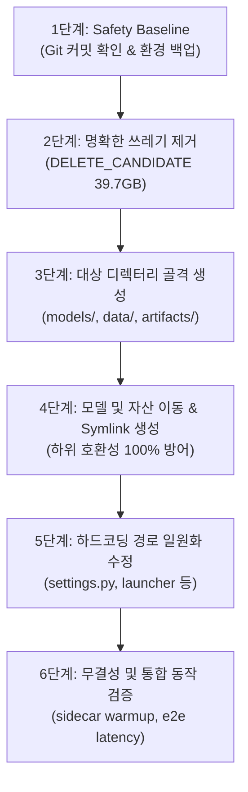

# 말로(Mallo) 저장소 및 로컬 실험 자산 전수조사 보고서 (Repository Cleanup Audit)

- **작성일자**: 2026-08-27
- **상태**: 기능 동결(Freeze) 완료에 따른 최종 정리 계획 (조사 완료 / 삭제 및 이동 미수행)
- **원칙**: 이번 단계에서는 파일 삭제, 이동, rename, 브랜치 삭제를 일체 수행하지 않고 실사 및 계획만 수립함

---

## 1. 개요 및 조사 결과 총평

말로(Mallo) 프로젝트의 기능 구현이 공식 동결됨에 따라, 최종 제출 및 인수인계를 위해 저장소 내부와 주변 파일시스템(홈 디렉터리, 상위 디렉터리, 워크트리 등)에 걸쳐 존재하는 모든 자산에 대해 전수조사를 수행하였다.

### 주요 핵심 발견 사항
1. **소스 코드 내 대규모 모델/데이터 적재 (`src/adapters/stt`)**:
   - `src/adapters/stt/stt_data`에 **179GB**(AIHub raw 170GB, train65 7.7GB 등)의 데이터가 적재되어 있음.
   - `src/adapters/stt/models`에 **18GB**의 Whisper 파인튜닝 체크포인트 및 머지 모델들이 적재되어 있음.
   - 즉, `src/` 디렉터리가 총 **197GB**를 차지하는 기형적 구조로, 순수 소스 코드와 로컬 대용량 산출물이 혼재되어 있음.
2. **프로덕션 TTS 모델의 위험한 보관 위치 (`logs/`)**:
   - 실제 시연 및 프로덕션 서비스에서 사용되는 유일한 MeloTTS 파인튜닝 체크포인트(`G_2800.pth`, 595MB)와 설정 파일(`config.json`)이 `logs/mallo-friendly/`에 위치함.
   - 로그 디렉터리는 통상 임시 파일이나 폐기 대상으로 취급되므로, 무분별한 `logs/` 정리 시 **핵심 런타임 모델이 영구 소실될 치명적인 위험**이 있음.
3. **대규모 폐기 및 중복 자산 식별 (~39.7GB)**:
   - MeloTTS로 확정되면서 폐기된 **Qwen3-TTS 실험 산출물 약 28.5GB**(`data/tts/runs/qwen3/`, `qwen3_lora_5ep/` 등) 적재.
   - 학습 중 손상된 **MeloTTS 손상 체크포인트 5.1GB**(`logs/mallo-friendly-corrupted/`).
   - `src/adapters/stt/models/fast-exp/`(1.5GB)와 `src/adapters/stt/models/team_handoff/fast-exp/`(1.5GB)는 **100% 완전 동일 바이너리 중복**이며, 추가로 `fast-exp.zip`(1.2GB)까지 3중 복제 상태임.
   - `team_handoff/whisper-medium-qlora-domain.zip`(1.2GB) 역시 압축 해제본이 존재하여 중복.
   - NLU 중단 실행본 `lora_r8.interrupted-*` 약 2.4GB.
   - 루트의 임시 오디오 디코딩 파일 `decoded_*.wav` (6.8MB) 및 임시 세션 `:memory:.ses`.
4. **심볼릭 링크 의존성**:
   - `src/adapters/stt/models/whisper-medium-qlora-domain/merged-bf16`은 상대 심링크(`../team_handoff/domain/merged-bf16`)로 연결되어 있어, 디렉터리 분리 이동 시 링크가 깨질 수 있음.
5. **외부 자산 존재**:
   - 홈 디렉터리에 팀 간 모델 전달용 백업인 `/home/honorbear/mallo-model-handoff` (2.1GB) 및 압축본 `mallo-model-handoff.tar.gz` (1.76GB)가 별도 보관되어 있음.

---

## 2. 영역별 최종 프로덕션 모델 및 Provenance 대조

| 영역 | 최종 모델 (FINAL_RUNTIME) | 체크섬 / 사양 | 선정 근거 (Evidence) | 롤백/대체 모델 | Provenance / 학습 출처 |
|---|---|---|---|---|---|
| **STT** | `src/adapters/stt/models/whisper-medium-qlora-train65-v1-lr2e-5-ep2-merged-bf16` | BF16 safetensors (1.52GB)<br>SHA256: `c0e432a4323d0303...` | `artifacts/stt-benchmark/20260826-131107/leaderboard.csv`에서 전체 후보 중 **CER 0.2056, WER 0.5137로 1위** 기록. | 1) `team_handoff/domain/merged-bf16`<br>2) `openai/whisper-medium` (Baseline) | Train65 데이터셋(7.7GB) 기반 Whisper-Medium QLoRA 학습 (lr=2e-5, ep=2) 후 BF16 merge |
| **NLU** | `models/nlu/qwen3-0.6b-sweeps/honorbear-20260825-021532-qwen3-0p6b-overnight/epochs4_seed7/merged-bf16` | BF16 safetensors (1.19GB)<br>Prompt Lookup=8 + Guard | `docs/specs/nlu-qwen06b-service-candidate.md`<br>Intent Acc: **100%**, Slot Acc: **96.78%**, Multi-order: **100%**, Valid JSON: **100%** | 1) `models/nlu/qwen3-1.7b-base` + `qwen3-1.7b-mallo-v2`<br>2) Mock NLU | Qwen3-0.6B Base 모델에 대해 nlu-orders 3,000+건으로 overnight sweep (epochs=4, seed=7) 후 BF16 merge |
| **TTS** | `logs/mallo-friendly/G_2800.pth`<br>(설정: `logs/mallo-friendly/config.json`) | PyTorch PTH (595MB)<br>SHA256: `858d23f61e724167...`<br>Speaker ID: `"10"` | `docs/specs/melotts-friendly-finetuning-poc.md`<br>주문/안내 도메인 발화 자연스러움 및 RTX 5070 Ti 실시간 합성 보장 | 1) MeloTTS Korean Baseline (`speaker="KR"`)<br>2) Mock TTS | AIHub 71349 친절 음성 데이터 299문장으로 MeloTTS-Korean 추가 파인튜닝 (Step 2800 체크포인트) |

---

## 3. 필수 표 10종

### [표 1] 로컬 자산 Inventory (Local Asset Inventory)

| 영역 | 분류 | 현재 경로 | 크기 | Git 추적 여부 | 용도 | 최종 사용 여부 | 제안 경로 | 비고 |
|---|---|---|---|---|---|---|---|---|
| STT | FINAL_RUNTIME | `src/adapters/stt/models/whisper-medium-qlora-train65-v1-lr2e-5-ep2-merged-bf16` | 1.5GB | 미추적 (.gitignore) | 프로덕션 STT 추론 모델 (Whisper Medium BF16 Merged) | **사용 (최종)** | `models/stt/final-train65-merged-bf16` | 현재 `whisper_medium.py` 기본값 |
| NLU | FINAL_RUNTIME | `models/nlu/qwen3-0.6b-sweeps/honorbear-20260825-021532-qwen3-0p6b-overnight/epochs4_seed7/merged-bf16` | 1.19GB | 미추적 (.gitignore) | 프로덕션 NLU 추론 모델 (Qwen3-0.6B BF16 Merged) | **사용 (최종)** | `models/nlu/final-qwen06b-merged-bf16` | 현재 `run_mallo_server.py` 기본값 |
| TTS | FINAL_RUNTIME | `logs/mallo-friendly/G_2800.pth` | 595MB | 미추적 (.gitignore) | 프로덕션 TTS 음성 합성 가중치 (MeloTTS 친절톤) | **사용 (최종)** | `models/tts/mallo-friendly/G_2800.pth` | `tts_sidecar_server.py` 기본값 |
| TTS | FINAL_RUNTIME | `logs/mallo-friendly/config.json` | 4.1KB | 미추적 (.gitignore) | MeloTTS 모델 아키텍처 및 화자 설정 | **사용 (최종)** | `models/tts/mallo-friendly/config.json` | `data/tts/runs/melotts/config.json`과 동일 |
| Common | FINAL_RUNTIME | `src/config/menu.json` | 10.5KB | **추적 (Commit됨)** | 키오스크 메뉴 및 옵션 정의 데이터베이스 | **사용 (최종)** | `src/config/menu.json` | 원위치 유지 |
| Common | FINAL_RUNTIME | `scripts/run_mallo_server.py` | 16KB | **추적 (Commit됨)** | 전체 서브프로세스 런처 및 게이트웨이 총괄 | **사용 (최종)** | `scripts/runtime/run_mallo_server.py` | 런타임 최상위 진입점 |
| STT | FINAL_RUNTIME | `scripts/stt_sidecar_server.py` | 4.6KB | **추적 (Commit됨)** | STT 루프백 HTTP 사이드카 서버 | **사용 (최종)** | `scripts/runtime/stt_sidecar_server.py` | 포트 8001 |
| NLU | FINAL_RUNTIME | `scripts/nlu_sidecar_server.py` | 7.0KB | **추적 (Commit됨)** | NLU 루프백 HTTP 사이드카 서버 | **사용 (최종)** | `scripts/runtime/nlu_sidecar_server.py` | 포트 8002 |
| TTS | FINAL_RUNTIME | `scripts/tts_sidecar_server.py` | 4.6KB | **추적 (Commit됨)** | TTS 루프백 HTTP 사이드카 서버 | **사용 (최종)** | `scripts/runtime/tts_sidecar_server.py` | 포트 8003 |
| Pipeline | FINAL_RUNTIME | `src/app/server.py` | 33KB | **추적 (Commit됨)** | 백엔드 오케스트레이터 및 Web Gateway | **사용 (최종)** | `src/app/server.py` | 원위치 유지 (포트 8000) |
| STT | FINAL_EVIDENCE | `artifacts/stt-benchmark/` | 3.9MB | 미추적 (.gitignore) | STT 전체 후보 모델 벤치마크 및 Leaderboard | 보존 (증빙) | `artifacts/stt/benchmark/` | 최신 run `20260826-131107` 포함 |
| NLU | FINAL_EVIDENCE | `artifacts/nlu-candidates/` | 5.0MB | 미추적 (.gitignore) | NLU 후보 모델 예측 결과 및 요약 | 보존 (증빙) | `artifacts/nlu/candidates/` | 1.7B 및 0.6B 비교 데이터 |
| NLU | FINAL_EVIDENCE | `artifacts/nlu-challenge/` | 768KB | 미추적 (.gitignore) | NLU 실전/스트레스 챌린지 평가 결과 | 보존 (증빙) | `artifacts/nlu/challenge/` | focused-v1 등 평가 결과 |
| NLU | FINAL_EVIDENCE | `models/nlu/focused-benchmarks/` | 944KB | 미추적 (.gitignore) | PR #209 타깃 환경 벤치마크 로그 및 메트릭 | 보존 (증빙) | `artifacts/nlu/focused-benchmarks/` | 보고서용 성능 수치 |
| NLU | FINAL_EVIDENCE | `models/nlu/service-optimization/` | 700KB | 미추적 (.gitignore) | NLU 서비스 추론 최적화 실험 지표 | 보존 (증빙) | `artifacts/nlu/service-optimization/` | KV cache/Prompt Lookup 결과 |
| NLU | FINAL_EVIDENCE | `models/nlu/qwen3-1.7b-mallo-v2/` | 78MB | 미추적 (.gitignore) | Qwen3-1.7B 파인튜닝 LoRA 어댑터 (Reference) | 보존 (증빙) | `models/nlu/reference-1.7b-mallo-v2/` | 0.6B와의 대조군 어댑터 |
| TTS | FINAL_EVIDENCE | 구버전 TTS 쇼케이스 | 235MB | 미추적 (.gitignore) | 적응형 TTS 레벨별 음성 쇼케이스 HTML/WAV | 보존 (증빙) | `artifacts/showcase/legacy/tts/` | 최신 final과 분리 보관 |
| TTS | FINAL_EVIDENCE | `data/tts/runs/benchmarks_gpu/` | 127MB | 미추적 (.gitignore) | GPU 기반 TTS 지연시간/음질 벤치마크 결과 | 보존 (증빙) | `artifacts/tts/benchmarks_gpu/` | RTF 및 지연시간 증빙 |
| TTS | FINAL_EVIDENCE | `data/tts/runs/benchmarks/` | 14MB | 미추적 (.gitignore) | TTS 모델 비교 벤치마크 원시 데이터 | 보존 (증빙) | `artifacts/tts/benchmarks/` | |
| TTS | FINAL_EVIDENCE | `data/tts/runs/melo_sweep/` | 36MB | 미추적 (.gitignore) | MeloTTS 음질 개선 파라미터 스윕 오디오/결과 | 보존 (증빙) | `artifacts/tts/melo_sweep/` | 파라미터 튜닝 증빙 |
| Pipeline | FINAL_EVIDENCE | `logs/qa-*.jsonl` (11개 파일) | 1.8MB | 미추적 (.gitignore) | 실마이크 및 E2E QA 세션 상호작용 로그 | 보존 (증빙) | `artifacts/pipeline/qa-logs/` | 8/26~8/27 실측 로그 |
| Pipeline | FINAL_EVIDENCE | `logs/nlu-*.log` | 2.2MB | 미추적 (.gitignore) | NLU 야간 스윕 및 집중 벤치마크 콘솔 로그 | 보존 (증빙) | `artifacts/nlu/training-logs/` | |
| STT | REPRODUCIBLE_SOURCE | `src/adapters/stt/stt_data/raw/` | 170GB | 미추적 (.gitignore) | AIHub STT 원본 오디오 (107, 71517, 71558, 94) | 재현용 (보관) | `data/stt/raw/` (또는 외장 아카이브) | 재다운로드 가능하나 대용량 |
| STT | REPRODUCIBLE_SOURCE | `src/adapters/stt/stt_data/train65_v1/` | 7.7GB | 미추적 (.gitignore) | 전처리 완료된 Train65 학습용 오디오/메타데이터 | 재현용 (보존) | `data/stt/processed/train65_v1/` | STT 최종 모델 재학습 데이터 |
| STT | REPRODUCIBLE_SOURCE | `src/adapters/stt/stt_data/splits/` | 156KB | 미추적 (.gitignore) | STT 데이터셋 split (train/val/test CSV) | 재현용 (보존) | `data/stt/splits/` | |
| STT | REPRODUCIBLE_SOURCE | `data/stt/splits/` | 144KB | **추적 (Commit됨)** | 저장소에 커밋된 표준 STT splits | 재현용 (보존) | `data/stt/splits/` | 원위치 유지 |
| NLU | REPRODUCIBLE_SOURCE | `data/nlu/raw/nlu-orders.csv` | 2.0MB | **추적 (Commit됨)** | NLU 3,000건 원본 주문 데이터셋 | 재현용 (보존) | `data/nlu/raw/nlu-orders.csv` | 원위치 유지 |
| NLU | REPRODUCIBLE_SOURCE | `data/nlu/processed/` | 1.8MB | 미추적 (.gitignore) | NLU train/validation/test jsonl 분할본 | 재현용 (보존) | `data/nlu/processed/` | 원위치 유지 |
| NLU | REPRODUCIBLE_SOURCE | `models/nlu/qwen3-1.7b-base/` | 3.8GB | 미추적 (.gitignore) | Qwen3-1.7B Base HuggingFace 모델 가중치 | 재현용 (보존) | `models/nlu/base/qwen3-1.7b` | 오프라인 재현용 |
| TTS | REPRODUCIBLE_SOURCE | `data/tts/aihub/` | 37GB | 미추적 (.gitignore) | AIHub 133번 감성 및 발화 스타일 원본 음성 | 재현용 (보관) | `data/tts/raw/aihub/` (또는 외장) | 재다운로드 가능하나 대용량 |
| TTS | REPRODUCIBLE_SOURCE | `data/tts/derived/aihub-71349/` | 1.1GB | 미추적 (.gitignore) | MeloTTS 파인튜닝용 정제 발화 데이터셋 | 재현용 (보존) | `data/tts/derived/aihub-71349/` | MeloTTS 재학습 필수 데이터 |
| TTS | REPRODUCIBLE_SOURCE | `data/tts/repos/MeloTTS/`, `Qwen3-TTS/` | 45MB | 미추적 (.gitignore) | 업스트림 오픈소스 엔진 서브모듈/클론 | 재현용 (보존) | `data/tts/repos/` | Git clone으로 재생성 가능 |
| STT | EXPERIMENT_ARCHIVE | `src/adapters/stt/models/whisper-medium-qlora-train65-v1-lr2e-5-ep2/` | 49MB | 미추적 (.gitignore) | 최종 모델 생성의 원본 LoRA 어댑터 가중치 | 보존 (이력) | `models/stt/adapters/train65-lr2e-5-ep2/` | BF16 merge 이전 adapter |
| STT | EXPERIMENT_ARCHIVE | `src/adapters/stt/models/team_handoff/domain/` | 1.5GB | 미추적 (.gitignore) | 팀 인계 도메인 파인튜닝 모델 (이전 1위) | 보존 (롤백용) | `models/stt/archive/team-handoff-domain/` | 롤백 후보 1 |
| STT | EXPERIMENT_ARCHIVE | `src/adapters/stt/models/whisper-medium-train65-v1-merged-bf16/` | 1.5GB | 미추적 (.gitignore) | 이전 Train65 머지 모델 | 보존 (이력) | `models/stt/archive/train65-v1-merged/` | |
| STT | EXPERIMENT_ARCHIVE | `src/adapters/stt/models/whisper-onnx/` | 1.2GB | 미추적 (.gitignore) | ONNX Runtime INT8 양자화 모델 | 보존 (이력) | `models/stt/archive/whisper-onnx/` | 성능 비교군 |
| STT | EXPERIMENT_ARCHIVE | `src/adapters/stt/models/whisper-medium-qlora-golden500-hpf/` | 2.0GB | 미추적 (.gitignore) | High-pass filter 전처리 sweep 실험 모델 | 보존 (이력) | `models/stt/archive/golden500-hpf/` | |
| STT | EXPERIMENT_ARCHIVE | `src/adapters/stt/models/whisper-medium-qlora-speaker-split/` | 1.6GB | 미추적 (.gitignore) | 화자 분할 기반 QLoRA 학습 모델 | 보존 (이력) | `models/stt/archive/speaker-split/` | |
| STT | EXPERIMENT_ARCHIVE | `src/adapters/stt/models/whisper-medium-qlora-kiosk-test/` | 1.6GB | 미추적 (.gitignore) | 키오스크 테스트셋 QLoRA 모델 | 보존 (이력) | `models/stt/archive/kiosk-test/` | |
| STT | EXPERIMENT_ARCHIVE | `src/adapters/stt/models/whisper-medium-qlora/` | 1.7GB | 미추적 (.gitignore) | 초기 Whisper Medium QLoRA 모델 | 보존 (이력) | `models/stt/archive/initial-qlora/` | |
| NLU | EXPERIMENT_ARCHIVE | `models/nlu/qwen3-0.6b-sweeps/honorbear-20260825-021532-qwen3-0p6b-overnight/` (정상 15개 run) | ~18.6GB | 미추적 (.gitignore) | 0.6B 하이퍼파라미터 탐색(lr, epoch, batch) run들 | 보존 (이력) | `models/nlu/archive/qwen06b-overnight-sweeps/` | 논문/보고서 탐색 이력 증빙 |
| NLU | EXPERIMENT_ARCHIVE | `models/nlu/qwen3-1.7b-lora/` | 7.0GB | 미추적 (.gitignore) | Qwen3-1.7B Native LoRA 실험 가중치 | 보존 (이력) | `models/nlu/archive/qwen1.7b-lora/` | Reference 모델 이력 |
| NLU | EXPERIMENT_ARCHIVE | `models/nlu/qwen3-1.7b-qlora/` | 3.5GB | 미추적 (.gitignore) | Qwen3-1.7B QLoRA 실험 가중치 | 보존 (이력) | `models/nlu/archive/qwen1.7b-qlora/` | |
| NLU | EXPERIMENT_ARCHIVE | `models/nlu/qwen3-0.6b-lora/` | 1.5GB | 미추적 (.gitignore) | Qwen3-0.6B 단일 LoRA 학습 가중치 | 보존 (이력) | `models/nlu/archive/qwen0.6b-lora/` | |
| TTS | EXPERIMENT_ARCHIVE | `logs/mallo-friendly/G_3000~3600.pth` (4개 파일) | 2.38GB | 미추적 (.gitignore) | Step 3000, 3200, 3400, 3600 생성자 체크포인트 | 보존 (이력) | `models/tts/archive/mallo-friendly-steps/` | 오버피팅 전후 비교 분석용 |
| STT | DELETE_CANDIDATE | `src/adapters/stt/models/fast-exp/` | 1.5GB | 미추적 (.gitignore) | `team_handoff/fast-exp`와 완전 동일한 바이너리 중복 | **미사용** | **삭제** | 100% 중복 확인 완료 |
| STT | DELETE_CANDIDATE | `src/adapters/stt/models/team_handoff/fast-exp.zip` | 1.2GB | 미추적 (.gitignore) | 이미 압축 해제된 fast-exp의 zip 파일 | **미사용** | **삭제** | 중복 아카이브 |
| STT | DELETE_CANDIDATE | `src/adapters/stt/models/team_handoff/whisper-medium-qlora-domain.zip` | 1.2GB | 미추적 (.gitignore) | 이미 압축 해제된 domain의 zip 파일 | **미사용** | **삭제** | 중복 아카이브 |
| STT | DELETE_CANDIDATE | `src/adapters/stt/models/*smoke*` (3개 디렉터리) | 90MB | 미추적 (.gitignore) | 스모크 테스트용 임시 어댑터 | **미사용** | **삭제** | 단순 파이프라인 검증용 |
| STT | DELETE_CANDIDATE | `src/adapters/stt/models/checkpoint_backups/` | 135MB | 미추적 (.gitignore) | 학습 중 생성된 임시 체크포인트 백업 | **미사용** | **삭제** | 중간 스텝 부산물 |
| NLU | DELETE_CANDIDATE | `models/nlu/qwen3-0.6b-sweeps/.../lora_r8.interrupted-*` (2개) | ~2.4GB | 미추적 (.gitignore) | 학습 중 비정상 중단된 sweep 체크포인트 | **미사용** | **삭제** | 손상/중단된 실행 |
| TTS | DELETE_CANDIDATE | `logs/mallo-friendly-corrupted/` | 5.1GB | 미추적 (.gitignore) | 발산/손상된 초기 MeloTTS 학습 산출물 | **미사용** | **삭제** | 명백한 손상 데이터 |
| TTS | DELETE_CANDIDATE | `data/tts/runs/qwen3/` | 26GB | 미추적 (.gitignore) | PoC 탈락으로 폐기된 Qwen3-TTS 전체 체크포인트 | **미사용** | **삭제** | MeloTTS 채택으로 폐기 |
| TTS | DELETE_CANDIDATE | `data/tts/runs/qwen3_lora_5ep/` | 2.4GB | 미추적 (.gitignore) | 폐기된 Qwen3-TTS LoRA 체크포인트 | **미사용** | **삭제** | MeloTTS 채택으로 폐기 |
| TTS | DELETE_CANDIDATE | `data/tts/runs/qwen3_50samples/`, `qwen3_full299/`, `qwen_capacity/` | ~89MB | 미추적 (.gitignore) | 폐기된 Qwen3-TTS 소규모 실험 산출물 | **미사용** | **삭제** | MeloTTS 채택으로 폐기 |
| TTS | DELETE_CANDIDATE | `logs/mallo-friendly/` 내 `D_*.pth`, `DUR_*.pth`, `G_0.pth` | 2.22GB | 미추적 (.gitignore) | 추론에 불필요한 Discriminator 및 Duration 가중치 | **미사용** | **삭제** | 오직 `G_2800.pth`만 추론에 필요 |
| Scratch | DELETE_CANDIDATE | `scratch/` (전체 7개 디렉터리) | 317MB | 미추적 (.gitignore) | 개발 도중 사용한 임시 디버깅 및 단위 테스트 잔여물 | **미사용** | **삭제** | 재생성 가능한 디버그 파일 |
| Common | DELETE_CANDIDATE | 루트 디렉터리의 `decoded_*.wav` (9개 파일) | 6.8MB | 미추적 (.gitignore) | 8/27 새벽 오디오 디코딩 테스트 출력 WAV | **미사용** | **삭제** | 임시 산출물 |
| Common | DELETE_CANDIDATE | 루트 디렉터리의 `:memory:.ses` | 51B | 미추적 (.gitignore) | 세션 임시 파일 | **미사용** | **삭제** | 임시 파일 |
| Common | UNKNOWN | `/home/honorbear/AI_Human_7th/worktrees/proj1d-stt-transcript-web-ux` | 11MB | 외부 worktree | 타 작업자의 이전 feature 브랜치 worktree | 미확정 | 보류 (확인 필요) | 별도 세션 작업 여부 확인 필요 |
| STT | UNKNOWN | `src/adapters/stt/models/whisper-medium-train65-golden-v1` | 30MB | 미추적 (.gitignore) | Golden 350샘플 1에폭 단독 학습 모델 | 미확정 | 보존 권장 | 특수 목적 실험 모델 여부 확인 |

---

### [표 2] 모델 Inventory (Model Inventory)

| STT/NLU/TTS | 모델/실험 | 현재 경로 | 학습 방식 | 주요 결과 (CER/WER/Acc/Latency) | production 사용 여부 | 상태 |
|---|---|---|---|---|---|---|
| **STT** | **Whisper Medium Train65 Merged** | `src/adapters/stt/models/whisper-medium-qlora-train65-v1-lr2e-5-ep2-merged-bf16` | QLoRA (r=8, alpha=16) + BF16 Full Merge | **CER: 0.2056, WER: 0.5137**, Latency Median: 238ms, P95: 386ms | **Production 최종 사용** | **FINAL_RUNTIME** |
| STT | Train65 QLoRA Adapter (Top-1) | `src/adapters/stt/models/whisper-medium-qlora-train65-v1-lr2e-5-ep2` | QLoRA (lr=2e-5, epochs=2) | 위 머지 모델의 소스 어댑터 (동일 성능) | 미사용 (머지본 사용) | EXPERIMENT_ARCHIVE |
| STT | Team Handoff Domain Merged | `src/adapters/stt/models/team_handoff/domain/merged-bf16` | Domain QLoRA + BF16 Merge | CER: 0.2262, WER: 0.5492, Latency P95: 261ms | **Rollback 후보 1** | EXPERIMENT_ARCHIVE |
| STT | Train65 Cafe Adapt v1 | `src/adapters/stt/models/whisper-medium-qlora-train65-cafe-adapt-v1` | QLoRA + Cafe SNR 적응 | CER: 0.2086, WER: 0.5155 (전체 2위) | 미사용 | EXPERIMENT_ARCHIVE |
| STT | Golden500 HPF Filter Sweep | `src/adapters/stt/models/whisper-medium-qlora-golden500-hpf/...` | QLoRA + High-pass filter | CER: 0.2262, WER: 0.5548 | 미사용 | EXPERIMENT_ARCHIVE |
| STT | Whisper Medium ONNX INT8 | `src/adapters/stt/models/whisper-onnx` | ONNX Runtime INT8 양자화 | ONNX CUDA 경량화 벤치마크용 | 미사용 | EXPERIMENT_ARCHIVE |
| STT | Fast-Exp (중복본) | `src/adapters/stt/models/fast-exp` | QLoRA 실험 | `team_handoff/fast-exp`와 완전 동일 | 미사용 | DELETE_CANDIDATE |
| STT | Smoke 및 임시 백업들 | `src/adapters/stt/models/*smoke*`, `checkpoint_backups` | 테스트/임시 | 불완전 체크포인트 | 미사용 | DELETE_CANDIDATE |
| **NLU** | **Qwen3-0.6B Overnight Merged** | `models/nlu/qwen3-0.6b-sweeps/honorbear-20260825-021532-qwen3-0p6b-overnight/epochs4_seed7/merged-bf16` | BF16 LoRA (r=16, alpha=32, ep=4, seed=7) + Merge | **Intent: 100%, Slot: 96.78%, Multi-cmd: 100%, Schema Valid: 100%**, Latency Median: 858ms | **Production 최종 사용** | **FINAL_RUNTIME** |
| NLU | Qwen3-0.6B LoRA Adapter (Top-1) | `.../epochs4_seed7/final-adapter` | LoRA (epochs=4, seed=7) | 위 머지 모델의 소스 어댑터 | 미사용 (머지본 사용) | EXPERIMENT_ARCHIVE |
| NLU | Qwen3-1.7B Reference Adapter | `models/nlu/qwen3-1.7b-mallo-v2` | QLoRA 파인튜닝 | Exact Match: 96.2%, Reference 성능 기준선 | **Reference / 비교군** | FINAL_EVIDENCE |
| NLU | Qwen3-1.7B Base 가중치 | `models/nlu/qwen3-1.7b-base` | HF Hub 다운로드 원본 | 1.7B LoRA 결합용 베이스 모델 | 재현용 | REPRODUCIBLE_SOURCE |
| NLU | Qwen3-0.6B Overnight Sweeps (15종) | `models/nlu/qwen3-0.6b-sweeps/.../[epochs4, lr1e4, mb16...]` | 하이퍼파라미터 그리드 탐색 | 각 파라미터별 수렴도/정확도 증빙 | 미사용 | EXPERIMENT_ARCHIVE |
| NLU | Qwen3-0.6B Interrupted Sweeps | `.../lora_r8.interrupted-*` (2개) | 중단된 학습 | 비정상 중단으로 결과 없음 | 미사용 | DELETE_CANDIDATE |
| **TTS** | **MeloTTS Korean Friendly Fine-tuned** | `logs/mallo-friendly/G_2800.pth`<br>(설정: `logs/mallo-friendly/config.json`) | VITS/MeloTTS 아키텍처 추가 파인튜닝 (Step 2800) | RTF: ~0.08 (12x 실시간), 고령자 친화 어조 안정 합성 | **Production 최종 사용** | **FINAL_RUNTIME** |
| TTS | MeloTTS Friendly Steps 3000~3600 | `logs/mallo-friendly/G_3000~3600.pth` | Step 3000~3600 체크포인트 | 후기 스텝 비교 분석용 | 미사용 | EXPERIMENT_ARCHIVE |
| TTS | MeloTTS 불필요 가중치 (D, DUR, G_0) | `logs/mallo-friendly/D_*.pth`, `DUR_*.pth`, `G_0.pth` | 학습용 보조 네트워크 가중치 | 추론 시 사용하지 않음 (발화 생성에 불필요) | 미사용 | DELETE_CANDIDATE |
| TTS | MeloTTS Corrupted Runs | `logs/mallo-friendly-corrupted/` | 실패한 초기 학습 | 오디오 깨짐/발산 확인 | 미사용 | DELETE_CANDIDATE |
| TTS | Qwen3-TTS 전체 체크포인트 | `data/tts/runs/qwen3/`, `qwen3_lora_5ep/` | Qwen3-TTS 12Hz 파인튜닝 | E2E 지연시간 미달 및 VRAM 과다로 채택 탈락 | 미사용 (폐기) | DELETE_CANDIDATE |

---

### [표 3] 데이터 Inventory (Data Inventory)

| 영역 | 데이터셋 | 현재 경로 | 단계 (raw/processed/split) | 크기 | 재생성 가능 여부 | 상태 |
|---|---|---|---|---|---|---|
| STT | AIHub 음성 원본 (107, 71517, 71558, 94) | `src/adapters/stt/stt_data/raw/` | raw | 170GB | 가능 (AIHub 재다운로드, 단 시간 소요) | REPRODUCIBLE_SOURCE |
| STT | Train65 정제/증강 데이터셋 | `src/adapters/stt/stt_data/train65_v1/` | processed | 7.7GB | 가능 (`prepare_domain_train.py` 재실행) | REPRODUCIBLE_SOURCE |
| STT | STT 데이터 분할 (CSV) | `src/adapters/stt/stt_data/splits/` | split | 156KB | 가능 (`split_dataset.py` 재실행) | REPRODUCIBLE_SOURCE |
| STT | Git 커밋된 표준 Splits | `data/stt/splits/` | split | 144KB | **불필요 (Git 보존)** | REPRODUCIBLE_SOURCE |
| STT | Heldout Golden 평가셋 | `src/adapters/stt/stt_data/heldout/` | processed / eval | 285MB | 불가 (선별된 황금 평가셋, 영구 보존 필수) | REPRODUCIBLE_SOURCE |
| STT | STT 외부 데이터셋 | `src/adapters/stt/stt_data/external/` | raw / processed | 436MB | 가능 | REPRODUCIBLE_SOURCE |
| STT | STT 재현성 검증 데이터 | `src/adapters/stt/stt_data/reproduction/` | processed | 522MB | 가능 | REPRODUCIBLE_SOURCE |
| STT | STT 데이터 감사 산출물 | `src/adapters/stt/stt_data/audit/` | audit / metadata | 146MB | 가능 | REPRODUCIBLE_SOURCE |
| NLU | NLU 주문 원본 데이터셋 | `data/nlu/raw/nlu-orders.csv` | raw | 2.0MB | **불필요 (Git 보존)** | REPRODUCIBLE_SOURCE |
| NLU | NLU 표준 전처리 분할본 | `data/nlu/processed/` | processed / split | 1.8MB | 가능 (`build_nlu_dataset.py` 등) | REPRODUCIBLE_SOURCE |
| NLU | Qwen3 형식 대화 템플릿 데이터 | `data/nlu/processed/qwen3/` | processed | 10MB | 가능 (전처리 스크립트 실행) | REPRODUCIBLE_SOURCE |
| NLU | Focused Challenge v1 | `data/nlu/challenges/focused-v1.jsonl` | challenge / eval | 86KB | 가능 (`build_nlu_focused_challenge_v1.py`) | REPRODUCIBLE_SOURCE |
| NLU | Mallo Real Challenge v1 | `data/nlu/challenge/mallo-real-v1.jsonl` | challenge / eval | 20KB | **불필요 (Git 보존)** | REPRODUCIBLE_SOURCE |
| TTS | AIHub 133번 원본 음성 | `data/tts/aihub/'133.감성 및...'` | raw | 37GB | 가능 (AIHub 재다운로드, 대용량) | REPRODUCIBLE_SOURCE |
| TTS | AIHub 71349 정제 추출본 | `data/tts/derived/aihub-71349/` | processed | 1.1GB | 가능 (`prepare_melotts_training.py`) | REPRODUCIBLE_SOURCE |
| TTS | TTS 평가용 문장셋 | `data/tts/evaluation/` | eval text | 20KB | **불필요 (Git 보존)** | FINAL_EVIDENCE |
| TTS | TTS 사전학습 설정/메타 | `data/tts/pretrain/` | metadata | 16KB | **불필요 (Git 보존)** | REPRODUCIBLE_SOURCE |
| TTS | 업스트림 엔진 레포지토리 | `data/tts/repos/` | source code | 45MB | 가능 (`git clone` 재수행) | REPRODUCIBLE_SOURCE |

---

### [표 4] Script Inventory (Script Inventory)

| 파일 | 목적 | 현재 사용 여부 | 참조되는 곳 | 제안 정리 위치 |
|---|---|---|---|---|
| `scripts/run_mallo_server.py` | STT/NLU/TTS 사이드카 및 Web Gateway 총괄 기동 | **현재 사용 (핵심)** | 전체 시연 및 프로덕션 실행 | `scripts/runtime/` |
| `scripts/stt_sidecar_server.py` | STT Train65 독립 프로세스 HTTP 서버 (포트 8001) | **현재 사용 (핵심)** | `run_mallo_server.py`가 호출 | `scripts/runtime/` |
| `scripts/nlu_sidecar_server.py` | Qwen3-0.6B NLU 독립 프로세스 HTTP 서버 (포트 8002) | **현재 사용 (핵심)** | `run_mallo_server.py`가 호출 | `scripts/runtime/` |
| `scripts/tts_sidecar_server.py` | MeloTTS 독립 프로세스 HTTP 서버 (포트 8003) | **현재 사용 (핵심)** | `run_mallo_server.py`가 호출 | `scripts/runtime/` |
| `scripts/run_local_server.py` | 인프로세스 로컬 개발 서버 기동 | 개발/테스트용 | 개발자 수동 실행 | `scripts/runtime/` |
| `scripts/run_desktop_e2e.py` | 데스크톱 환경 실시간 E2E 측정 실행 | 벤치마크용 | CI 및 성능 측정 시 | `scripts/eval/` |
| `scripts/measure_real_e2e_latency.py` | 마이크 입력부터 TTS 출력까지 실제 지연시간 측정 | 벤치마크용 | E2E 성능 검증 시 | `scripts/eval/` |
| `scripts/measure_e2e_latency.py` | Mock 파이프라인 지연시간 계측 | 과거 개발용 | E2E baseline 검증 시 | `scripts/eval/` |
| `scripts/benchmark_stt_candidates.py` | STT 전체 후보 모델 CER/WER/지연시간 스윕 평가 | **현재 사용 (핵심)** | `artifacts/stt-benchmark` 생성 | `scripts/eval/` |
| `scripts/evaluate_nlu_qwen06b_guard.py` | NLU 결정론적 가드 규칙 효과 정량 평가 | **현재 사용 (핵심)** | NLU 서비스 평가 | `scripts/eval/` |
| `scripts/benchmark_qwen3_1p7b_reference_pipeline.py` | Qwen3-1.7B Reference 파이프라인 벤치마크 | 비교용 | 1.7B 성능 대조 시 | `scripts/eval/` |
| `scripts/run_nlu_three_candidate_focus.py` | NLU 상위 3개 후보 모델 집중 비교 평가 | 비교용 | 후보 압축 시 | `scripts/eval/` |
| `scripts/run_nlu_real_challenge.py` | NLU 실전 챌린지 데이터셋 평가 | 검증용 | 챌린지 셋 평가 시 | `scripts/eval/` |
| `scripts/build_nlu_focused_challenge_v1.py` | NLU 합성 스트레스 챌린지 데이터셋 생성기 | 데이터 빌더 | `focused-v1.jsonl` 생성 | `scripts/tools/` |
| `scripts/build_nlu_real_challenge.py` | NLU 실전 챌린지 데이터셋 생성기 | 데이터 빌더 | `mallo-real-v1.jsonl` 생성 | `scripts/tools/` |
| `scripts/run_nlu_qwen06b_training.py` | Qwen3-0.6B NLU 기본 LoRA 파인튜닝 | 학습용 | 단일 학습 실행 시 | `scripts/train/` |
| `scripts/run_nlu_qwen06b_overnight_sweep.py` | Qwen3-0.6B NLU 야간 하이퍼파라미터 그리드 탐색 | 학습용 (완료) | overnight sweeps 생성 | `scripts/train/` |
| `scripts/run_nlu_qwen06b_overnight_max.py` | Qwen3-0.6B NLU 장시간 학습 스크립트 | 학습용 (완료) | | `scripts/train/` |
| `scripts/run_nlu_qwen06b_resume.py` | NLU 중단 체크포인트 재개 학습기 | 복구용 | | `scripts/train/` |
| `scripts/run_nlu_qwen06b_supervisor.sh` | NLU 야간 학습 자동 모니터링/재시작 셸 | 인프라/감시 | | `scripts/tools/` |
| `scripts/run_nlu_bf16_service_optimization.sh` | NLU BF16 서비스 최적화 실행 셸 | 최적화용 | | `scripts/tools/` |
| `scripts/run_nlu_qwen06b_bf16_baseline.sh` | NLU BF16 베이스라인 실행 셸 | 베이스라인용 | | `scripts/tools/` |
| `scripts/merge_nlu_qwen06b_adapter.py` | 0.6B LoRA 어댑터를 Base 모델과 BF16 병합 | **현재 사용 (핵심)** | 최종 서비스 모델 머지 | `scripts/tools/` |
| `scripts/merge_qwen_nlu_adapter.py` | Qwen NLU 어댑터 범용 머지 도구 | 도구 | | `scripts/tools/` |
| `scripts/convert_stt_ct2.py` | STT Whisper 모델 CTranslate2 변환 | 실험용 | 경량화 시도 시 | `scripts/tools/` |
| `scripts/melo_quality_enhancement.py` | MeloTTS 친절톤 음질 파라미터 스윕 | 튜닝용 | 음질 개선 시 | `scripts/tools/` |
| `scripts/auto_evaluate_checkpoints.py` | MeloTTS 체크포인트 실시간 자동 합성 평가 | 학습 감시용 | 과거 학습 시 | `scripts/eval/` |
| `scripts/generate_adaptive_levels_player.py` | 적응형 TTS 레벨 데모 플레이어 HTML 생성 | 데모 빌더 | legacy TTS 생성 | `scripts/showcase/` |
| `scripts/generate_adaptive_levels_player_v2.py` | 적응형 TTS 레벨 플레이어 v2 HTML 생성 | **현재 사용 (데모)** | 최신 showcase HTML 생성 | `scripts/showcase/` |
| `scripts/build_all_models_standalone.py` | TTS 전체 모델 비교 독립형 HTML 플레이어 생성 | 데모 빌더 | legacy TTS 생성 | `scripts/showcase/` |
| `scripts/build_private_tts_showcase_site.py` | 비공개 배포용 정적 쇼케이스 사이트 빌더 | 배포 빌더 | private-site 생성 | `scripts/showcase/` |
| `scripts/create_shareable_showcase.py` | 공유용 TTS 쇼케이스 단일 HTML 생성 | 데모 빌더 | | `scripts/showcase/` |
| `scripts/generate_unified_player.py` | 통합 음성 플레이어 생성기 | 데모 빌더 | | `scripts/showcase/` |
| `scripts/watch_and_synthesize.py` | 새 체크포인트 발생 시 자동 음성 합성 | 튜닝용 | | `scripts/tools/` |
| `scripts/train_qwen3_*.py` (3개 파일) | 폐기된 Qwen3-TTS 학습 스크립트 | 과거 실험 (미사용) | Qwen3-TTS 학습 시 | `scripts/archive/` (또는 삭제) |
| `scripts/qwen_*.py` (4개 파일) | 폐기된 Qwen3-TTS 심층 진단/감사 도구 | 과거 실험 (미사용) | Qwen3-TTS 디버그 시 | `scripts/archive/` (또는 삭제) |
| `scripts/verify_nlu_qwen06b_*.py` (4개 파일) | NLU 계약, 토크나이저, 모델 무결성 검증 | **현재 사용 (테스트)** | CI 및 사전 검증 | `scripts/tools/` |
| `scripts/smoke_nlu_qwen06b_bf16_lora.py` | NLU QLoRA 스모크 테스트 | 테스트용 | 빠른 검증 시 | `scripts/tools/` |
| `scripts/check_python_env.py` | Python 3.11 및 패키지 환경 검증기 | 유틸리티 | 환경 초기 설정 시 | `scripts/tools/` |
| `src/adapters/stt/finetune_whisper_qlora.py` | STT Whisper QLoRA 파인튜닝 메인 스크립트 | **핵심 학습 소스** | Train65 학습 시 | `src/adapters/stt/` (유지) |
| `src/adapters/stt/merge_qlora_adapter.py` | STT Whisper QLoRA 어댑터 BF16 병합 도구 | **핵심 머지 소스** | STT 최종 모델 생성 | `src/adapters/stt/` (유지) |
| `src/adapters/stt/baseline_qlora_compare.py` | STT 베이스라인과 QLoRA 비교 평가 스크립트 | 평가용 | 도메인 평가 시 | `src/adapters/stt/` (유지) |
| `src/adapters/tts/prepare_melotts_training.py` | MeloTTS AIHub 데이터 전처리 및 슬라이싱 | **핵심 데이터 소스** | MeloTTS 학습 데이터 생성 | `src/adapters/tts/` (유지) |

---

### [표 5] 하드코딩된 경로 목록 (Hardcoded Path References)

| 파일 | 현재 경로 참조 | 문제점 | 수정 제안 |
|---|---|---|---|
| `scripts/run_mallo_server.py` (L25) | `DEFAULT_NLU_MODEL = ROOT / "models/nlu/qwen3-0.6b-sweeps/honorbear-20260825-021532-qwen3-0p6b-overnight/epochs4_seed7/merged-bf16"` | 21GB에 달하는 야간 스윕 중간 산출물 깊숙한 경로를 기본값으로 직접 참조함. 스윕 아카이빙 시 경로 파손 위험. | `DEFAULT_NLU_MODEL = ROOT / "models/nlu/final-qwen06b-merged-bf16"` (canonical 경로)로 통일하고 환경변수 주입 허용 |
| `scripts/run_mallo_server.py` (L269-270) | `--tts-checkpoint`: `ROOT / "logs/mallo-friendly/G_2800.pth"`<br>`--tts-config`: `ROOT / "logs/mallo-friendly/config.json"` | **최고 위험**: 프로덕션 핵심 가중치가 임시 디렉터리인 `logs/`를 바라봄. 로그 정리 시 모델 영구 소실. | `models/tts/mallo-friendly/G_2800.pth`로 이동하고, CLI 기본값을 해당 경로로 수정 |
| `scripts/tts_sidecar_server.py` (L98-99) | `--checkpoint`: `"logs/mallo-friendly/G_2800.pth"`<br>`--config`: `"logs/mallo-friendly/config.json"` | `run_mallo_server.py`와 동일한 `logs/` 참조 문제 | `models/tts/mallo-friendly/`를 기본값으로 변경 |
| `src/adapters/stt/whisper_medium.py` (L71-75) | `DEFAULT_TRAIN65_MERGED_PATH = Path(__file__).resolve().parent / "models" / "whisper-medium-qlora-train65-v1-lr2e-5-ep2-merged-bf16"` | 모델 가중치가 소스 코드 디렉터리(`src/adapters/stt/models`) 내부에 하드코딩되어 소스 트리를 비대하게 만듦. | 저장소 루트의 `models/stt/final-train65-merged-bf16`을 참조하도록 수정하거나 `settings.py`에서 주입 |
| `src/config/settings.py` (L111-117) | `QLORA_MERGED_PATH = STT_DIR / "models" / "whisper-medium-qlora-domain" / "merged-bf16"` | `src/adapters/stt/models` 내부의 심볼릭 링크를 참조함. 심링크가 깨지면 즉시 런타임 에러 발생. | 루트 `models/stt/` 계층으로 이관하고 절대/상대 경로 안전성 확보 |
| `scripts/benchmark_stt_candidates.py` (L39-46) | `DEFAULT_EVAL_DIR = ROOT / "src/adapters/stt/stt_data/domain_eval"`<br>`"clean-kiosk": ROOT / "src/adapters/stt/stt_data/heldout/..."` | 179GB 데이터가 소스 코드 디렉터리(`src/adapters/stt/stt_data`) 내부에 위치하여 벤치마크 코드가 `src/` 내부 데이터를 참조함. | `data/stt/` 루트 디렉터리로 이관 후 경로 갱신 |
| `scripts/benchmark_stt_candidates.py` (L153) | `models_root / "team_handoff/domain/merged-bf16"` | 롤백 모델 경로가 `team_handoff` 내부에 하드코딩됨 | `models/stt/archive/team-handoff-domain/`으로 이동 후 경로 수정 |
| `scripts/measure_real_e2e_latency.py` (L114-118) | `ckpt_path = Path("logs/mallo-friendly/G_2800.pth")`<br>`config_path = Path("logs/mallo-friendly/config.json")` | 지연시간 측정 스크립트가 `logs/` 경로를 하드코딩함 | `models/tts/`의 표준 모델 경로로 수정 |
| `scripts/generate_adaptive_levels_player_v2.py` (L72-76) | `ckpt_path = "logs/mallo-friendly/G_2800.pth"`<br>`config_path = "logs/mallo-friendly/config.json"` | 쇼케이스 생성기가 `logs/` 경로를 하드코딩함 | `models/tts/` 표준 경로로 수정 |
| `scripts/convert_stt_ct2.py` (L64-72) | `ROOT / "src" / "adapters" / "stt" / "models" / "whisper-medium-qlora-domain" / "merged-bf16"` | 변환 스크립트가 `src/` 내부 모델을 하드코딩함 | 표준 `models/stt/` 경로로 수정 |
| `src/adapters/tts/eval_synthesis.py` (L311-324) | `data/tts/runs/qwen3/checkpoints-lr1e5/...`<br>`logs/mallo-friendly` | 폐기된 Qwen3 경로 및 `logs/`를 기본값으로 지정 | 폐기 경로 제거 및 MeloTTS 표준 경로 반영 |
| `src/app/server.py` (L697-702) | `help="Path to fine-tuned TTS checkpoint (e.g. logs/mallo-friendly/G_2800.pth)"` | CLI 도움말 및 예시가 과거 `logs/` 경로를 가리킴 | 도움말 문구를 새 표준 `models/tts/` 경로로 갱신 |

---

### [표 6] 정리 후 추천 디렉터리 Tree (Target Directory Structure)

```text
/home/honorbear/AI_Human_7th/proj1-d/
├── .env.example
├── AGENTS.md
├── README.md
├── requirements.txt
├── requirements-dev.txt
├── requirements-runtime-cu128.txt
├── requirements-nlu-cu128.txt
├── requirements-tts-melo.txt
├── requirements-tts-qwen.txt
├── requirements-tts.txt
│
├── models/                         # [공통 모델 보관소] - Git 미추적 (.gitignore)
│   ├── stt/
│   │   ├── final-train65-merged-bf16/   # [FINAL_RUNTIME] 최종 STT 모델 (1.5GB)
│   │   ├── adapters/                    # 주요 검증 어댑터 (Train65 lr2e-5 ep2 등)
│   │   └── archive/                     # 롤백 및 비교 모델 (team_handoff, onnx 등)
│   ├── nlu/
│   │   ├── final-qwen06b-merged-bf16/   # [FINAL_RUNTIME] 최종 NLU 모델 (1.2GB)
│   │   ├── reference-1.7b-mallo-v2/     # [FINAL_EVIDENCE] 1.7B 대조군 어댑터 (78MB)
│   │   ├── base/qwen3-1.7b/             # [REPRODUCIBLE_SOURCE] 1.7B Base 가중치 (3.8GB)
│   │   └── archive/                     # overnight sweeps 및 과거 lora 보존본
│   └── tts/
│       ├── mallo-friendly/              # [FINAL_RUNTIME] 최종 TTS 모델 (G_2800.pth + config.json)
│       └── archive/                     # MeloTTS Step 3000~3600 체크포인트 보존본
│
├── data/                           # [공통 데이터 보관소]
│   ├── stt/
│   │   ├── splits/                      # [Git 추적] train/val/test CSV
│   │   ├── eval-results/                # [Git 추적] 벤치마크 요약 CSV
│   │   ├── heldout/                     # [보존] Golden 평가 오디오/CSV (285MB)
│   │   ├── processed/train65_v1/        # [보존] Train65 정제 오디오 (7.7GB)
│   │   └── raw/                         # [선택 보존/외장 이전] AIHub 원본 오디오 (170GB)
│   ├── nlu/
│   │   ├── raw/nlu-orders.csv           # [Git 추적] 3,000건 주문 원본
│   │   ├── processed/                   # [보존] jsonl 분할 및 qwen3 포맷 (12MB)
│   │   └── challenges/                  # [Git 추적 및 보존] mallo-real-v1, focused-v1
│   └── tts/
│       ├── evaluation/                  # [Git 추적] 평가용 문장 메타데이터
│       ├── pretrain/                    # [Git 추적] 사전학습 설정
│       ├── derived/aihub-71349/         # [보존] MeloTTS 학습 정제 음성 (1.1GB)
│       ├── repos/                       # [보존] MeloTTS / Qwen3-TTS 소스
│       └── raw/aihub/                   # [선택 보존/외장 이전] AIHub 133번 원본 (37GB)
│
├── artifacts/                      # [평가 증빙 및 벤치마크 결과]
│   ├── stt/
│   │   └── benchmark/                   # Leaderboard, Candidates, 에러 로그
│   ├── nlu/
│   │   ├── candidates/                  # 1.7B/0.6B 예측 결과
│   │   ├── challenge/                   # 실전/스트레스 챌린지 결과
│   │   ├── focused-benchmarks/          # PR #209 타깃 환경 벤치마크
│   │   └── service-optimization/        # 추론 최적화 측정 데이터
│   ├── tts/
│   │   ├── showcase/                    # 적응형 레벨 데모 플레이어 HTML/WAV
│   │   ├── benchmarks_gpu/              # GPU 지연시간 측정 증빙
│   │   └── melo_sweep/                  # 파라미터 스윕 결과
│   └── pipeline/
│       └── qa-logs/                     # 8/26~8/27 실마이크 상호작용 JSONL 로그
│
├── scripts/                        # [스크립트 계층화]
│   ├── runtime/                         # 런타임 서버 및 사이드카
│   │   ├── run_mallo_server.py          # 최상위 런처
│   │   ├── stt_sidecar_server.py
│   │   ├── nlu_sidecar_server.py
│   │   ├── tts_sidecar_server.py
│   │   └── run_local_server.py
│   ├── train/                           # 모델 학습 스크립트
│   │   ├── run_nlu_qwen06b_training.py
│   │   └── run_nlu_qwen06b_overnight_sweep.py
│   ├── eval/                            # 평가 및 벤치마크
│   │   ├── benchmark_stt_candidates.py
│   │   ├── evaluate_nlu_qwen06b_guard.py
│   │   ├── measure_real_e2e_latency.py
│   │   └── run_desktop_e2e.py
│   ├── showcase/                        # 데모 및 쇼케이스 생성
│   │   ├── generate_adaptive_levels_player_v2.py
│   │   └── build_private_tts_showcase_site.py
│   └── tools/                           # 검증, 변환, 머지, 데이터 빌더
│       ├── merge_nlu_qwen06b_adapter.py
│       ├── build_nlu_focused_challenge_v1.py
│       ├── check_python_env.py
│       └── verify_nlu_qwen06b_*.py
│
├── src/                            # [순수 소스 코드] (대용량 모델/데이터 완전 배제)
│   ├── adapters/                        # STT, NLU, TTS, Audio, Logging 어댑터 구현체
│   │   ├── stt/                         # 모델/데이터 제거 -> 순수 파이썬 코드만 남김 (~200KB)
│   │   ├── nlu/
│   │   └── tts/
│   ├── app/                             # Web 서버 및 서비스 오케스트레이션
│   ├── domain/                          # 도메인 모델, 주문 규칙, 인텐트 정의
│   ├── interfaces/                      # 파이프라인 계약 인터페이스
│   └── config/                          # 메뉴 DB 및 전역 설정
│
├── tests/                          # [단위/통합 테스트]
├── web/                            # [프론트엔드 정적 파일]
└── docs/                           # [문서, Spec, TRD, PRD]
```

> **[핵심 안전 설계 - Symlink 하위 호환 전략]**
> 기존 코드의 참조 경로가 깨지는 참사를 방지하기 위해:
> 1. `src/adapters/stt/models` 위치에 `ln -s ../../../models/stt src/adapters/stt/models` 심링크를 생성한다.
> 2. `src/adapters/stt/stt_data` 위치에 `ln -s ../../../data/stt src/adapters/stt/stt_data` 심링크를 생성한다.
> 3. `logs/mallo-friendly/G_2800.pth` 위치에 `ln -s ../../models/tts/mallo-friendly/G_2800.pth logs/mallo-friendly/G_2800.pth` 심링크를 생성한다.
> 4. `scripts/` 루트에는 `runtime/` 스크립트들을 바라보는 심볼릭 링크 또는 래퍼를 유지하여 기존 실행 명령(`python scripts/run_mallo_server.py`)이 그대로 동작하도록 보장한다.

---

### [표 7] 이동 계획 (Move & Migration Plan)

| 현재 경로 | 제안 경로 | 이동 방식 | 하위 호환 대책 |
|---|---|---|---|
| `src/adapters/stt/models/whisper-medium-qlora-train65-v1-lr2e-5-ep2-merged-bf16` | `models/stt/final-train65-merged-bf16` | 디렉터리 이동 | `src/adapters/stt/models/`에 역방향 symlink 제공 |
| `models/nlu/qwen3-0.6b-sweeps/honorbear-20260825-021532-qwen3-0p6b-overnight/epochs4_seed7/merged-bf16` | `models/nlu/final-qwen06b-merged-bf16` | 디렉터리 이동 (또는 복사/symlink) | 기존 sweep 경로에 symlink 유지 |
| `logs/mallo-friendly/G_2800.pth` | `models/tts/mallo-friendly/G_2800.pth` | 파일 이동 | `logs/mallo-friendly/G_2800.pth` 위치에 symlink 생성 |
| `logs/mallo-friendly/config.json` | `models/tts/mallo-friendly/config.json` | 파일 이동 | `logs/mallo-friendly/config.json` 위치에 symlink 생성 |
| `src/adapters/stt/models/whisper-medium-qlora-train65-v1-lr2e-5-ep2` | `models/stt/adapters/train65-lr2e-5-ep2` | 디렉터리 이동 | 보존 |
| `src/adapters/stt/models/team_handoff/domain/` | `models/stt/archive/team-handoff-domain/` | 디렉터리 이동 | 기존 symlink 갱신 |
| `src/adapters/stt/models/whisper-medium-train65-v1-merged-bf16` | `models/stt/archive/train65-v1-merged/` | 디렉터리 이동 | 보존 |
| `src/adapters/stt/models/whisper-onnx` | `models/stt/archive/whisper-onnx/` | 디렉터리 이동 | 보존 |
| `src/adapters/stt/models/whisper-medium-qlora-*` (golden500, speaker, kiosk 등) | `models/stt/archive/` 하위 | 디렉터리 이동 | 보존 |
| `src/adapters/stt/stt_data/heldout` | `data/stt/heldout` | 디렉터리 이동 | `src/adapters/stt/stt_data/` symlink로 커버 |
| `src/adapters/stt/stt_data/train65_v1` | `data/stt/processed/train65_v1` | 디렉터리 이동 | `src/adapters/stt/stt_data/` symlink로 커버 |
| `src/adapters/stt/stt_data/splits` | `data/stt/splits_v1` | 디렉터리 이동 | `data/stt/splits` (git 추적본)과 병합/대조 |
| `src/adapters/stt/stt_data/raw` | `data/stt/raw` (또는 외장 이전) | 디렉터리 이동 | 170GB 대용량이므로 로컬 디스크 상태 따라 결정 |
| `data/tts/aihub` | `data/tts/raw/aihub` (또는 외장 이전) | 디렉터리 이동 | 37GB 대용량이므로 로컬 디스크 상태 따라 결정 |
| `logs/qa-*.jsonl` | `artifacts/pipeline/qa-logs/` | 파일 이동 | `logs/` 디렉터리 순수화 |
| `logs/nlu-*.log` | `artifacts/nlu/training-logs/` | 파일 이동 | `logs/` 디렉터리 순수화 |
| 구버전 TTS standalone HTML 및 `raw/`, `private-site/` | `artifacts/showcase/legacy/tts/` | 디렉터리/파일 이동 | `docs/` 디렉터리 문서 순수화 (용량 235MB -> 1MB로 감소) |
| `scripts/run_mallo_server.py` 등 런타임 | `scripts/runtime/` | 이동 (점진적) | `scripts/` 루트에 래퍼 유지 |
| `scripts/benchmark_*.py` 등 평가 | `scripts/eval/` | 이동 | |
| `scripts/run_nlu_*training*.py` 등 학습 | `scripts/train/` | 이동 | |
| `scripts/generate_*player*.py` 등 쇼케이스 | `scripts/showcase/` | 이동 | |
| `scripts/verify_*.py`, `check_*.py` 등 도구 | `scripts/tools/` | 이동 | |

---

### [표 8] 삭제 후보 (Delete Candidates)

| 삭제 대상 경로 | 대상 크기 | 대상 설명 | 삭제 근거 | 재생성 가능 여부 |
|---|---|---|---|---|
| `src/adapters/stt/models/fast-exp/` | 1.5GB | 과거 STT 빠른 실험 체크포인트 디렉터리 | `src/adapters/stt/models/team_handoff/fast-exp/`와 **100% 바이너리 동일** (diff 검증 완료) | 이미 동일 복사본 존재 |
| `src/adapters/stt/models/team_handoff/fast-exp.zip` | 1.2GB | `fast-exp`의 zip 압축본 | 이미 압축 해제된 `fast-exp/`가 존재하므로 단순 중복 용량 점유 | 필요시 zip 재압축 가능 |
| `src/adapters/stt/models/team_handoff/whisper-medium-qlora-domain.zip` | 1.2GB | `domain` 모델의 zip 압축본 | 이미 압축 해제된 `domain/`이 존재하므로 단순 중복 용량 점유 | 필요시 zip 재압축 가능 |
| `logs/mallo-friendly-corrupted/` | 5.1GB | 손상된 초기 MeloTTS 파인튜닝 체크포인트들 | 발화 오염 및 손상으로 폐기 확정된 실패 실험 산출물 | 실패 실험으로 재생성 불필요 |
| `data/tts/runs/qwen3/` | 26GB | Qwen3-TTS 파인튜닝 체크포인트 전체 | MeloTTS가 최종 모델로 확정 채택됨에 따라 폐기된 아키텍처 | 코드(`train_qwen3_*.py`) 보존으로 재학습 가능 |
| `data/tts/runs/qwen3_lora_5ep/` | 2.4GB | Qwen3-TTS LoRA 5에폭 체크포인트 | MeloTTS 채택으로 인한 폐기 실험 | 코드 보존으로 재학습 가능 |
| `data/tts/runs/qwen3_50samples/` | 40MB | Qwen3-TTS 50샘플 소규모 실험 산출물 | 폐기 실험 | 재학습 가능 |
| `data/tts/runs/qwen3_full299/` | 44MB | Qwen3-TTS 299샘플 실험 산출물 | 폐기 실험 | 재학습 가능 |
| `data/tts/runs/qwen_capacity/` | 5.1MB | Qwen3-TTS 용량 한계 측정 실험 | 폐기 실험 | 재실행 가능 |
| `models/nlu/qwen3-0.6b-sweeps/.../lora_r8.interrupted-1787614170` | ~1.2GB | GPU 메모리 또는 세션 중단으로 비정상 종료된 체크포인트 | 미완료 비정상 산출물 | 재학습 가능 |
| `models/nlu/qwen3-0.6b-sweeps/.../lora_r8.interrupted-1787614664` | ~1.2GB | 비정상 중단된 체크포인트 | 미완료 비정상 산출물 | 재학습 가능 |
| `src/adapters/stt/models/whisper-medium-qlora-train65-v1-smoke/` | 30MB | STT 학습 파이프라인 검증용 스모크 모델 | 단순 기능 검증용 임시 파일 | 스크립트 실행으로 즉시 재생성 |
| `src/adapters/stt/models/whisper-medium-qlora-train65-cafe-adapt-v1-smoke/` | 30MB | Cafe 적응 스모크 모델 | 단순 기능 검증용 임시 파일 | 즉시 재생성 가능 |
| `src/adapters/stt/models/train65-b8-prefetch-smoke/` | 30MB | 프리페치 기능 검증용 스모크 모델 | 단순 기능 검증용 임시 파일 | 즉시 재생성 가능 |
| `src/adapters/stt/models/checkpoint_backups/` | 135MB | STT 학습 중 저장된 이전 스텝 백업들 | 최종 체크포인트가 정상 완료되어 불필요 | 불필요 |
| `logs/mallo-friendly/D_0.pth`, `D_3400.pth`, `D_3600.pth` | 1.6GB | MeloTTS Discriminator 판별자 네트워크 가중치 | 추론 파이프라인에 전혀 사용되지 않음 (학습 시에만 사용) | 학습 재개 안 할 시 불필요 |
| `logs/mallo-friendly/DUR_0.pth`, `DUR_3200.pth`, `DUR_3400.pth`, `DUR_3600.pth` | 26MB | MeloTTS Duration 프레딕터 중간 가중치 | 최종 `G_2800.pth` 내부에 필요한 파라미터가 포함되어 불필요 | 불필요 |
| `logs/mallo-friendly/G_0.pth` | 595MB | MeloTTS 파인튜닝 Step 0 초기 가중치 | 사전학습 기본 모델과 동일하며 파인튜닝 효과 없음 | 기본 모델에서 즉시 로드 가능 |
| `scratch/` (7개 서브디렉터리 전체) | 317MB | `nlu-qwen06b`, `smoke_test_*`, `test_trainer_debug*` 등 | 개발 도중 사용한 임시 디버깅 및 단위 테스트 잔여물 | 재생성 가능 |
| 루트 디렉터리의 `decoded_*.wav` (9개 파일) | 6.8MB | 8/27 새벽 오디오 디코딩 테스트 출력 WAV | 임시 테스트 파일 | 스크립트 재실행으로 생성 가능 |
| 루트 디렉터리의 `:memory:.ses` | 51B | SQLite 인메모리 세션 잔여물 | 임시 캐시 | 세션 시작 시 자동 생성 |
| `.pytest_cache/` | 140KB | Pytest 실행 캐시 | 테스트 프레임워크 캐시 | `pytest` 실행 시 자동 재생성 |
| **삭제 후보 총계** | **~39.66 GB** | **35개 디렉터리/파일 군** | **디스크 39.7GB 즉시 확보 가능** | |

---

### [표 9] UNKNOWN / 사람이 판단해야 할 항목 (Items Requiring Human Decision)

| 항목 | 현재 경로 | 크기 | 불확실한 점 (근거 부족) | 권장 조치 방안 |
|---|---|---|---|---|
| **외부 Git Worktree** | `/home/honorbear/AI_Human_7th/worktrees/proj1d-stt-transcript-web-ux` | 11MB | 다른 팀원 또는 별도 세션에서 `feat/stt-transcript-web-ux` 브랜치 작업을 진행 중인지, 이미 병합되어 방치된 워크트리인지 불분명함. | 담당 팀원(또는 브랜치 작성자)에게 확인 후, 이미 main에 병합되었다면 `git worktree remove` 수행 |
| **Golden v1 STT 모델** | `src/adapters/stt/models/whisper-medium-train65-golden-v1` | 30MB | `splits/train.csv` 350샘플 1에폭만 학습하여 CER 0.2026을 기록한 모델. Train65 v1-lr2e-5-ep2 이전의 중간 실험 모델인지, 특별한 golden 데이터 실험 모델인지 명확한 문서화가 부족함. | 임의 삭제하지 않고 `models/stt/archive/`로 안전 이관하여 보존 |
| **AIHub 원본 대용량 데이터의 저장소 외부 이전** | `src/adapters/stt/stt_data/raw/` (170GB)<br>`data/tts/aihub/` (37GB) | 총 207GB | 최종 제출용 코드 저장소 디렉터리 내에 207GB의 원본 음성을 보관하는 것이 맞는지, 아니면 별도 외장 스토리지나 공용 NAS/S3로 오프로드하고 저장소에는 전처리된 최소 데이터만 남길지 판단 필요. | 최종 제출 시 압축/패키징 용량을 고려할 때, 원본 raw 음성은 외장 드라이브로 백업 후 저장소 트리에서는 제외하는 것을 강력 권장 |
| **외부 Handoff 패키지 보존 여부** | `/home/honorbear/mallo-model-handoff` (2.1GB)<br>`/home/honorbear/mallo-model-handoff.tar.gz` (1.76GB) | 총 3.86GB | 8/24 인계받은 테스트 파일 패키지로, 내부 모델들은 이미 저장소 내부에 설치되어 있음. 독립된 백업본으로 유지할 것인지 판단 필요. | 최종 정리가 완료되고 시스템 검증이 끝날 때까지는 안전망(Safety net)으로 삭제하지 않고 유지 권장 |

---

### [표 10] 실행 순서 (Safe Execution Protocol)

추후 실제 파일 정리 작업을 진행할 때 안전성을 100% 담보하기 위해 다음 **6단계 순차 실행 프로토콜**을 엄격히 준수해야 한다.



#### 1단계: Safety Baseline 확보 (검증 및 잠금)
- 현재 `main` 브랜치 상태가 깨끗한지(`git status -s`) 재확인.
- 백업 태그 또는 정리 전 전용 브랜치(`chore/cleanup-assets-prep`) 생성.
- 외부 handoff 패키지(`/home/honorbear/mallo-model-handoff.tar.gz`)가 온전한지 SHA256 체크섬 재검증.

#### 2단계: 무위험 DELETE_CANDIDATE 제거 (39.7GB 디스크 확보)
- 런타임 및 재현성에 전혀 영향이 없는 완전 중복 파일 먼저 삭제:
  - `src/adapters/stt/models/fast-exp/` (1.5GB 중복 디렉터리)
  - `src/adapters/stt/models/team_handoff/*.zip` (2.4GB 중복 압축본)
  - `logs/mallo-friendly-corrupted/` (5.1GB 손상본)
  - `data/tts/runs/qwen3/`, `qwen3_lora_5ep/` (28.4GB 폐기 아키텍처)
  - `scratch/` (317MB), 루트 `decoded_*.wav` (6.8MB), `:memory:.ses` (51B)
  - `lora_r8.interrupted-*` (2.4GB)
  - MeloTTS 불필요 가중치 `D_*.pth`, `DUR_*.pth`, `G_0.pth` (2.2GB)

#### 3단계: 신규 추천 디렉터리 구조 골격 생성
- 신규 루트 디렉터리 생성:
  - `mkdir -p models/stt/final-train65-merged-bf16 models/stt/adapters models/stt/archive`
  - `mkdir -p models/nlu/final-qwen06b-merged-bf16 models/nlu/archive models/nlu/base`
  - `mkdir -p models/tts/mallo-friendly models/tts/archive`
  - `mkdir -p artifacts/stt/benchmark artifacts/nlu artifacts/tts artifacts/pipeline/qa-logs`
  - `mkdir -p data/stt/raw data/stt/processed`

#### 4단계: 모델 및 데이터 이동과 Symlink 브리지 구축 (Zero Downtime)
- **STT**:
  - `src/adapters/stt/models/whisper-medium-qlora-train65-v1-lr2e-5-ep2-merged-bf16`의 파일들을 `models/stt/final-train65-merged-bf16/`으로 이동.
  - 기존 경로에는 `models/stt/final-train65-merged-bf16`을 가리키는 심볼릭 링크 생성.
  - 나머지 STT 아카이브 모델 이동 후 `src/adapters/stt/models`는 통째로 `models/stt`를 가리키는 심링크로 연결.
- **NLU**:
  - `epochs4_seed7/merged-bf16`을 `models/nlu/final-qwen06b-merged-bf16/`으로 복사/이동하고 기존 경로 심링크 연결.
- **TTS**:
  - `logs/mallo-friendly/G_2800.pth`와 `config.json`을 `models/tts/mallo-friendly/`로 이동.
  - `logs/mallo-friendly/G_2800.pth` 위치에 심볼릭 링크 생성 (기존 스크립트 파손 방지).
- **Showcase / Logs**:
  - 구버전 TTS standalone HTML을 `artifacts/showcase/legacy/tts/`로 이동.
  - `logs/qa-*.jsonl`을 `artifacts/pipeline/qa-logs/`로 이동.

#### 5단계: 하드코딩 경로 일원화 및 설정 반영
- `src/config/settings.py`에 STT/NLU/TTS 기본 모델 경로 상수 정의:
  ```python
  DEFAULT_STT_MODEL_PATH = ROOT / "models/stt/final-train65-merged-bf16"
  DEFAULT_NLU_MODEL_PATH = ROOT / "models/nlu/final-qwen06b-merged-bf16"
  DEFAULT_TTS_MODEL_PATH = ROOT / "models/tts/mallo-friendly/G_2800.pth"
  DEFAULT_TTS_CONFIG_PATH = ROOT / "models/tts/mallo-friendly/config.json"
  ```
- `scripts/run_mallo_server.py`의 기본 인자 경로를 위 상수로 교체.
- `scripts/tts_sidecar_server.py`, `scripts/stt_sidecar_server.py`, `scripts/nlu_sidecar_server.py`의 CLI 기본값 동기화.

#### 6단계: 전체 파이프라인 무결성 및 실시간 기동 검증
- 가상환경 검증: `.venv-runtime-cu128`, `.venv-nlu-cu128` 무결성 점검.
- 사이드카 개별 기동 및 Warmup 테스트:
  - STT warmup: `POST http://127.0.0.1:8001/warmup` -> 응답 확인
  - NLU warmup: `POST http://127.0.0.1:8002/warmup` -> 응답 확인
  - TTS warmup: `POST http://127.0.0.1:8003/warmup` -> 응답 확인
- 게이트웨이 기동: `python scripts/run_mallo_server.py --tunnel none` 실행 후 브라우저 접속 및 주문 시연 검증.
- 단위 테스트 실행: `pytest tests/unit` 통과 확인.
- 최종 검증 통과 시 정리 커밋(`chore: re-organize repository assets and clean duplicates`) 생성.

---

## 4. 최종 요약 통계

- **FINAL_RUNTIME**: **11 items / 3.13 GB**
  - STT Whisper-Medium Train65 Merged BF16 (1.52GB)
  - NLU Qwen3-0.6B Overnight epochs4_seed7 Merged BF16 (1.19GB)
  - TTS MeloTTS Friendly Step 2800 (`G_2800.pth` 595MB + `config.json` 4KB)
  - 핵심 런타임 런처 및 사이드카 스크립트 5종 + 설정 파일 2종
- **FINAL_EVIDENCE**: **49 items / 1.14 GB**
  - STT/NLU/TTS 벤치마크, Leaderboard, 쇼케이스 플레이어 HTML (235MB)
  - 1.7B Reference 어댑터 (78MB), GPU 벤치마크 결과, 실마이크 QA 로그 11종
- **REPRODUCIBLE_SOURCE**: **19 items / 414.66 GB**
  - STT 원본 음성 (170GB) 및 Train65 전처리 데이터 (7.7GB)
  - TTS AIHub 원본 음성 (37GB) 및 71349 정제 데이터 (1.1GB)
  - NLU 3,000건 원본 데이터 및 전처리/챌린지 데이터셋
  - Qwen3-1.7B Base 원본 모델 (3.8GB)
  - 전체 소스 코드(`src/`) 및 실행 스크립트(`scripts/`)
- **EXPERIMENT_ARCHIVE**: **39 items / 49.21 GB**
  - STT 이전 머지 모델 및 각종 QLoRA 어댑터들 (Train65 1위 어댑터, Team handoff 도메인 머지, ONNX 등 약 15GB)
  - NLU Overnight Sweep 15개 run 산출물 및 1.7B/0.6B 이전 LoRA 모델들 (약 30GB)
  - TTS 후기 스텝 체크포인트들 (Step 3000~3600 약 2.4GB)
  - 외부 인계 패키지 원본 (약 3.86GB)
- **DELETE_CANDIDATE**: **35 items / 39.66 GB**
  - 바이너리 100% 동일 중복 모델 (`fast-exp` 1.5GB) 및 중복 zip 압축본 (2.4GB)
  - 폐기된 Qwen3-TTS 전체 체크포인트 (28.5GB)
  - 손상된 MeloTTS 체크포인트 (5.1GB)
  - 비정상 중단 NLU 스윕 run들 (2.4GB)
  - TTS 추론 불필요 가중치 (`D_*.pth`, `DUR_*.pth`, `G_0.pth` 2.2GB)
  - 스모크 모델, 중간 체크포인트 백업, scratch 디렉터리, 임시 WAV 등
- **UNKNOWN**: **2 items / 38.53 MB**
  - 외부 worktree `proj1d-stt-transcript-web-ux` (11MB)
  - `whisper-medium-train65-golden-v1` (30MB)

---

## 5. 핵심 위험 요소 및 최종 결정 필요 사항

### 가장 위험한 하드코딩 경로 TOP 3
1. **TTS 체크포인트의 `logs/` 디렉터리 배치**:
   - `logs/mallo-friendly/G_2800.pth`
   - 위험도: **극상 (Critical)**. 로그 정리 목적으로 `rm -rf logs/`를 실행하는 순간 유일한 프로덕션 TTS 모델 가중치가 즉시 소실됨.
2. **소스 디렉터리(`src/`) 내 197GB 데이터/모델 적재**:
   - `src/adapters/stt/stt_data/` (179GB), `src/adapters/stt/models/` (18GB)
   - 위험도: **상 (High)**. 소스 코드 관리와 배포 아티팩트의 경계가 무너져 있으며, 내부 심볼릭 링크(`whisper-medium-qlora-domain/merged-bf16 -> ../team_handoff/domain/merged-bf16`)가 상대 경로로 얽혀 있어 파일 분리 시 파손 위험이 큼.
3. **NLU 모델의 깊은 스윕 하위 경로 참조**:
   - `models/nlu/qwen3-0.6b-sweeps/honorbear-20260825-021532-qwen3-0p6b-overnight/epochs4_seed7/merged-bf16`
   - 위험도: **중 (Medium)**. 21GB에 달하는 야간 스윕 디렉터리 깊숙이 프로덕션 모델이 묻혀 있어, 스윕 정리 시 함께 삭제되거나 경로가 깨질 우려가 큼.

### 최종 정리 전에 사람이 결정해야 할 사항
1. **170GB STT Raw 및 37GB TTS Raw 음성 데이터의 아카이빙 위치 결정**:
   - 로컬 디스크에 그대로 유지할 것인지, 외장 하드/클라우드 저장소로 옮기고 저장소 내에서는 전처리 데이터(`data/stt/processed/`, `data/tts/derived/`)만 유지할 것인지 팀 차원의 결정 필요.
2. **폐기 대상 39.7GB(Qwen3-TTS, Corrupted run, 중복 zip 등)의 영구 삭제 승인**:
   - 본 보고서에서 식별한 35개 DELETE_CANDIDATE 항목을 실제로 영구 삭제(`rm -rf`)하여 디스크를 확보할 것인지 최종 승인 필요.
3. **외부 Worktree (`proj1d-stt-transcript-web-ux`) 처리**:
   - 해당 워크트리가 다른 작업자의 미완료 작업인지 확인 후 워크트리 해제(`git worktree remove`) 여부 결정 필요.
4. **Symlink 기반 하위 호환 브리지 도입 승인**:
   - 제안한 `models/` 및 `data/` 표준 구조로 이동하되, 기존 `src/adapters/stt/models`, `logs/mallo-friendly/` 등에 심볼릭 링크를 유지하는 안전 정리 방식 채택 여부 결정 필요.
